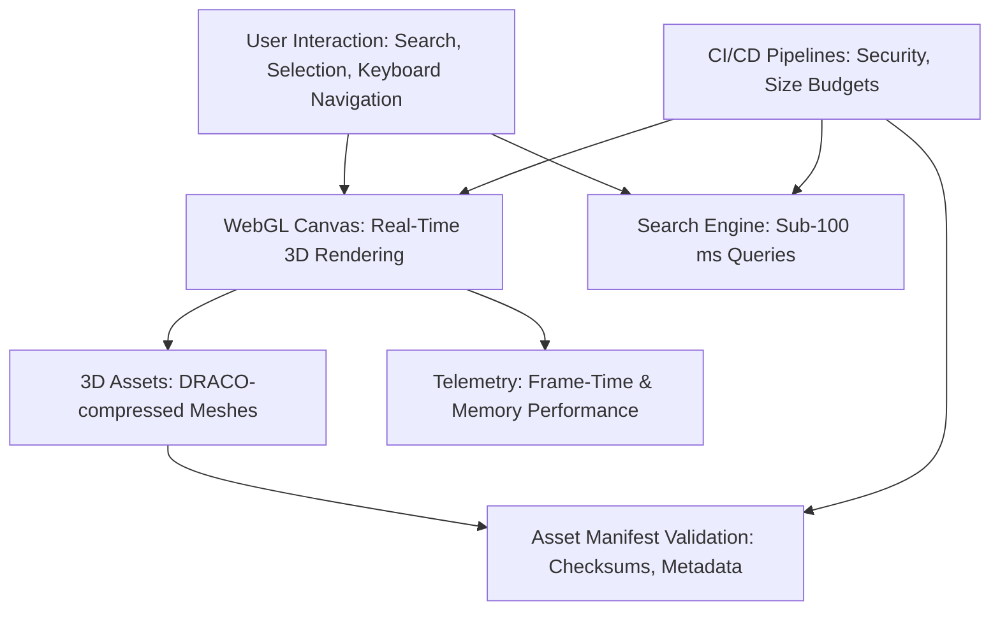

# Human Atlas


## Executive Summary

**Human Atlas** leverages cutting-edge 3D rendering and web technologies to create a high-performance, accessible, and scientifically validated visualization platform for human anatomical models. It delivers real-time exploration of thousands of interconnected 3D anatomical meshes at 60 FPS, with sub-100 ms search precision, designed to serve medical professionals, educators, and researchers.

---

## Key Features

- **Real-Time 3D Rendering**: Explore thousands of anatomical meshes with GPU-accelerated instancing and DRACO-compressed assets.
- **Performance Optimizations**: Progressive asset loading, WebGL context recovery, and telemetry-driven frame stability ensure smooth rendering across diverse devices, from high-powered desktops to low-memory mobile devices.
- **Accessibility First**: Full keyboard navigation, screen reader support, and canvas interaction alternatives tested against assistive technologies.
- **Robust Validation**: Asset manifest verification enforces checksums, provenance, licensing, anatomical identifiers, triangle counts, and compression ratios.
- **Search & Interaction**: Sub-100 ms text search with synchronization between deep links, selections, and visibility layers.
- **Layered & Exploded Views**: Intuitive controls for adjusting layer visibility and anatomical "exploded" perspectives.
- **Automated Testing Pipeline**: Regression tests for WebGL context loss, failed downloads, memory disposal, and search indexing guarantee stability.
- **Continuous Deployment**: CI-integrated workflows enforce budget limits for security, bundle size, and 3D mesh size, while modernizing dependencies incrementally.

---

## Architecture & Workflow



The system utilizes a tightly scoped pipeline that emphasizes performance and correctness. Key contributors are isolated via well-defined subsystem boundaries, ensuring maintainability and scalability.

---

## Tech Stack & Tools Breakdown

- **Frontend**: React 18.2, shadcn/ui, Vite
- **3D Rendering**: Three.js (0.153), DRACO-compressed assets
- **Programming Language**: TypeScript 5+
- **CI/CD**: Automated workflows for asset validation, performance benchmarking, and regression testing
- **Testing**: Jest and Testing Library for comprehensive unit and integration tests
- **Linting & Formatting**: ESLint, Prettier
- **Cloud Infrastructure**: AWS S3 for asset hosting, CloudFront for CDN delivery

---

## Quickstart / Installation

Follow these steps to set up **Human Atlas** locally:

1. **Clone the Repository**:
   ```bash
   git clone https://github.com/EF361/human-atlas.git
   cd human-atlas
   ```

2. **Install Dependencies**:
   ```bash
   npm install
   ```

3. **Start Development Server**:
   ```bash
   npm run dev
   ```

4. **Run Tests**:
   ```bash
   npm test
   ```

5. **Build for Production**:
   ```bash
   npm run build
   ```

6. **Serve Production Build**:
   ```bash
   npm run preview
   ```

---

## Benchmarks & Accessibility

### Performance Benchmarks
- **60 FPS** achieved on modern desktop GPUs and mid-range mobile devices.
- **Sub-100 ms search latency** validated against representative anatomical search queries.
- **Asset size limits** enforced to stay within memory constraints of low-end devices.

### Accessibility Verification
- Screen-reader workflows tested on NVDA, JAWS, and VoiceOver.
- Canvas interaction alternatives function seamlessly with keyboard-only navigation.
- ARIA roles and labels ensure compliance with WCAG standards.

---

## Contributions & Feedback

We welcome contributions and feedback! Please create issues or pull requests to report bugs, suggest features, or submit improvements. See [`CONTRIBUTING.md`](CONTRIBUTING.md) for guidelines.

---

## License

This project is licensed under the MIT License. See the [`LICENSE`](LICENSE) file for details.