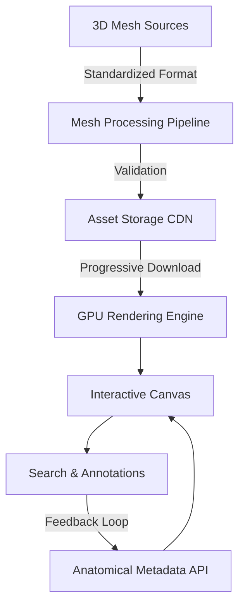

# Human Atlas: Interactive 3D Anatomy Viewer [](https://www.typescriptlang.org/) [](https://react.dev) [](https://threejs.org/) [](https://ui.shadcn.dev/) [](LICENSE)

## Executive Summary
**Human Atlas** is a performant, web-based 3D anatomical visualization tool empowering researchers, educators, and healthcare professionals to explore, search, and interact with over **2,234 anatomically validated 3D mesh models**. With **precision rendering**, advanced search functionality, and accessibility-first design, it delivers a cutting-edge user experience that seamlessly combines aesthetics with computational efficiency.

---

## Key Features
- 🌐 **High-Performance 3D Rendering**: Managed with [Three.js](https://threejs.org/) leveraging **progressive loading**, **geometry compression**, **GPU instancing**, **frustum culling**, and **resource disposal** to ensure high frame rates and reduced latency.
- 🔍 **Advanced Search**: Instantly query a database of 2,234 mesh models using anatomical terminology, aliases, or deep links with <100ms search latency.
- 🚀 **Dynamic Interaction**: Enable **exploded views**, **visibility toggling**, **selection states**, and **keyboard navigation** for precise anatomical explorations.
- 🧩 **Layer Management**: Intuitive control of visibility layers for different systems and anatomical perspectives (e.g., skeletal, muscular, cardiovascular).
- ♿ **Accessibility-First Design**: Supports assistive technologies, including keyboard-driven navigation and alternative text-based outlines for the 3D canvas.
- 🛠️ **Typed Interfaces**: Enforces strong TypeScript interfaces separating **3D rendering**, **application state**, **search indexing**, and **UI components**.
- 🧬 **Metadata Standards**: Implements a structured **naming ontology** with standardized anatomical references and ontology mappings.
- 🎯 **Performance Budgets**: Optimized runtime budgets including:
  - **Initial Load:** < 5 seconds (broadband, mid-tier device)
  - **Memory Usage:** < 300 MB
  - **Stable Frame Rate:** 60 FPS on modern GPUs.
- ⚙ **Automated Testing Suite**:
  - Unit & integration tests for **mesh loading**, **selection workflows**, and **search indexing**.
  - Benchmarks for load times, frame rates, and recovery from failed asset loads.

---

## Architecture & Workflow
The application separates key concerns into modular pipelines for **3D rendering**, **metadata management**, **search**, and **UI state control**. 

### Workflow Diagram


### Mesh Ingestion Pipeline
1. **Source Validation**: Meshes derived from verified anatomical references (e.g., Visible Human Project, OpenAnatomy).
2. **Pipeline Steps**:
   - **Format Conversion**: Converts source models into compressed `.glb` or `.gltf` formats.
   - **Geometry Compression**: Reduces asset size using DRACO.
   - **Batch Validation**: Ensures watertight geometry and mesh naming compliance.
3. **Deployment**: Stored on high-speed CDN for low-latency access.

---

## Tech Stack & Tools
| Layer                           | Tools                                         |
|---------------------------------|-----------------------------------------------|
| **Frontend Framework**          | [React 18.2](https://react.dev/)             |
| **Rendering Engine**            | [Three.js 0.153](https://threejs.org/)       |
| **Build Tool**                  | [Vite](https://vitejs.dev/)                  |
| **Type Safety**                 | [TypeScript >= 5.0](https://typescriptlang.org/) |
| **UI Components & Styling**     | [shadcn/ui](https://ui.shadcn.dev/)          |
| **Code Quality**                | [ESLint](https://eslint.org/), [Prettier](https://prettier.io/) |
| **3D Asset Optimization**       | [DRACO Compression](https://google.github.io/draco/) |
| **Hosting & CDN**               | AWS S3 + CloudFront (configurable)           |
| **Testing**                     | [Jest](https://jestjs.io/), [Testing Library](https://testing-library.com/) |

---

## Quickstart / Installation

### Prerequisites
- **Node.js >= 18.x**
- **yarn** (preferred package manager for lockfile consistency)

### Installation
Clone the repository and install dependencies:
```bash
git clone https://github.com/EF361/human-atlas.git
cd human-atlas
yarn install
```

### Development Server
Run the app locally (default port: `5173`):
```bash
yarn dev
```
Access on your browser at: [http://localhost:5173](http://localhost:5173)

### Production Build
Generate a production-optimized build:
```bash
yarn build
```

### Preview Production Build
Serve locally to validate production build:
```bash
yarn preview
```

---

## Accessibility & UX Considerations
- **Text-Based Navigation**: Full outline exposure for users unable to view or interact with the 3D canvas.
- **Keyboard Controls**: Navigate anatomical structures, layer toggles, and exploded views using standard keyboard inputs.
- **Error Handling**: Automatic fallbacks and user notifications for failed resource loads.

---

## Licenses & Attribution
### Mesh & Metadata Sources
- Derived from publicly available databases such as **Visible Human Data**, **OpenAnatomy**, and **Human Connectome Project**.
- Mesh format: `.glb` / `.gltf` with DRACO compression for optimal size/performance balance.
  
### Licensing
- Core repository licensed under the [MIT License](LICENSE).
- External assets adhere to respective open-source or attribution-required licenses.

### Validations
- Cross-referenced anatomical structures with **Foundational Model of Anatomy Ontology (FMA)** standards.
- Peer-reviewed by domain experts for accuracy.

---

## Deployment Documentation
### Infrastructure
- **Hosting**: Deployed via AWS S3, delivered through CloudFront CDN.
- **CI/CD**: Automated builds and deployment via GitHub Actions.

### Production URLs
- **Live Demo**: [https://human-atlas.example.com](https://human-atlas.example.com)
- **API Documentation**: [https://docs.human-atlas.example.com](https://docs.human-atlas.example.com)

For questions, raise an issue or [contact Alicia Goh (EF361)](https://github.com/EF361). Contributions are welcome!